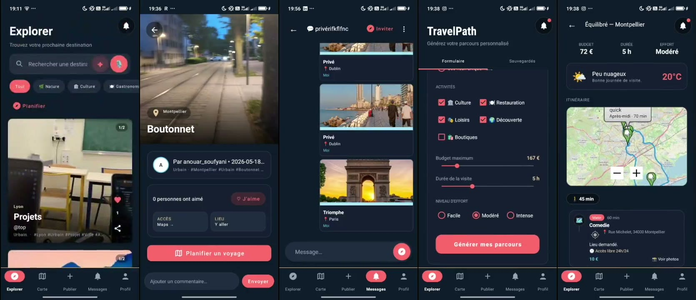
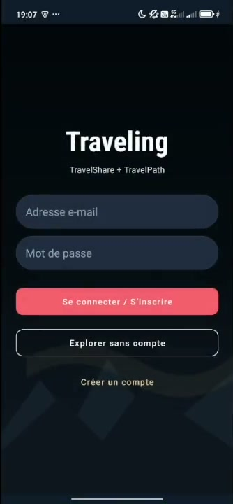
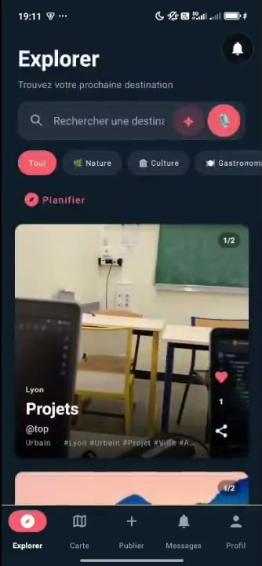
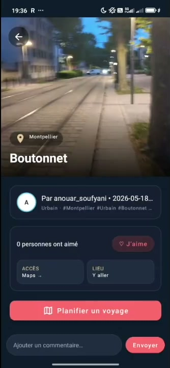
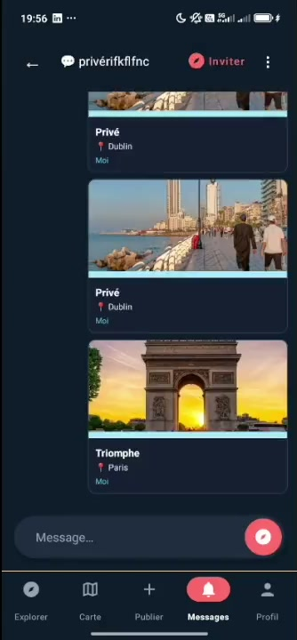
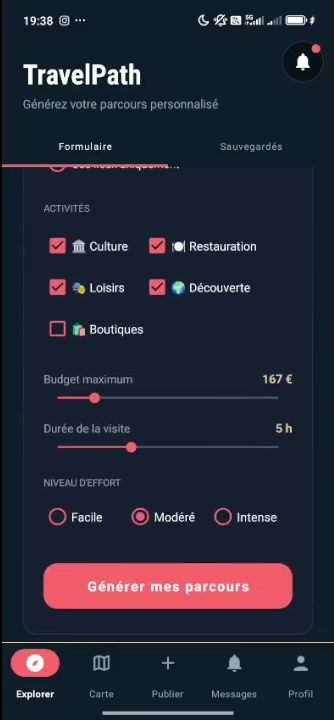

# Traveling — TravelShare & TravelPath


Application Android complète autour du voyage, composée de deux modules complémentaires : **TravelShare**, un réseau social de photos de voyage, et **TravelPath**, un générateur d'itinéraires personnalisés.

> UE Programmation Mobile — Université de Montpellier 2025-2026  
> Sofiane Hammar · Anouar Soufyani



---

## Modules

### TravelShare — Réseau social de voyages
- Inscription / connexion Firebase Auth (email ou anonyme)
- Publication multi-images avec **note vocale AAC** et **tagging IA** (ML Kit)
- Feed avec 8 filtres (Nature, Urbain, Culture, Magasin, Localisation, Likes…)
- Recherche texte + vocale en temps réel
- Profil public style Instagram — follow/unfollow, abonnés cliquables
- Groupes publics et privés + **chat temps réel** (Firestore, 4 types de messages)
- Conversations directes entre utilisateurs
- Carte interactive **OSMDroid** avec pins photos géolocalisés
- Notifications synchronisées Firestore (likes, commentaires, messages de groupe, invitations), avec notification système chez le destinataire

### TravelPath — Générateur d'itinéraires
- Formulaire : ville, 5 activités, budget, durée, niveau d'effort
- **3 types de parcours** générés : économique, équilibré, confort
- Vrais lieux via **Overpass API** (OpenStreetMap), fallback Nominatim
- Tracé routier calculé par **OSRM** avec durées réelles
- Météo temps réel **Open-Meteo** par étape
- Export **PDF natif** (Canvas Android, format A4)
- Partage de parcours dans les groupes de discussion

### Captures d'écran

| Connexion | Explorer | Détail d'une photo | Groupes |
|---|---|---|---|
|  |  |  |  |
| **Chat de groupe** | **TravelPath — formulaire** | **TravelPath — parcours** | |
|  |  |  | |

### Passerelle bidirectionnelle
- TravelShare → TravelPath : destination transmise automatiquement depuis une photo
- TravelPath → TravelShare : "Voir des photos" par étape de parcours

---

## Architecture

```
MVVM — Pattern recommandé par Google

Vue (Fragments / Activities)
    │ observe LiveData
    ▼
ViewModel (SharedViewModel · TravelPathViewModel)
    │ Repository pattern
    ├──► FirebaseRepository ──► Firebase Auth · Firestore · Cloudinary
    └──► AppDatabase (Room v31)
              12 entités locales
              Pool de 4 threads
```

| Donnée | Local (Room) | Cloud (Firestore) |
|---|---|---|
| Photos | Cache vidé au démarrage | Source principale (snapshot listener) |
| Plans TravelPath | Source principale | Copie si liké |
| Groupes & messages | Cache local | Source de référence + temps réel |
| Notifications | Stockage principal | Propagation inter-appareils |

---

## Stack technique

| Couche | Technologies |
|---|---|
| **Langage** | Java |
| **Architecture** | MVVM + LiveData + ViewModel |
| **Base de données locale** | Room v31 — 12 entités |
| **Authentification** | Firebase Auth (email + anonyme) |
| **Cloud / temps réel** | Firebase Firestore |
| **Stockage images** | Cloudinary |
| **Cartographie** | OSMDroid |
| **Routage** | OSRM |
| **Lieux** | Overpass API + Nominatim |
| **Météo** | Open-Meteo |
| **IA (tags images)** | ML Kit Image Labeling |
| **Build** | Gradle Kotlin DSL |

---

## Lancer le projet

Prérequis : **Android Studio** (JDK 21 inclus) et un émulateur ou un téléphone Android 7.0+.

1. Cloner le dépôt et l'ouvrir dans Android Studio
2. Attendre la synchronisation Gradle
3. Le fichier `app/google-services.json` est inclus : Firebase est prêt
4. Lancer sur un émulateur ou un appareil physique

En ligne de commande :

```bash
./gradlew assembleDebug        # APK dans app/build/outputs/apk/debug/
```

## Documentation

Le rapport complet du projet est disponible dans [`docs/Rapport.pdf`](docs/Rapport.pdf).
